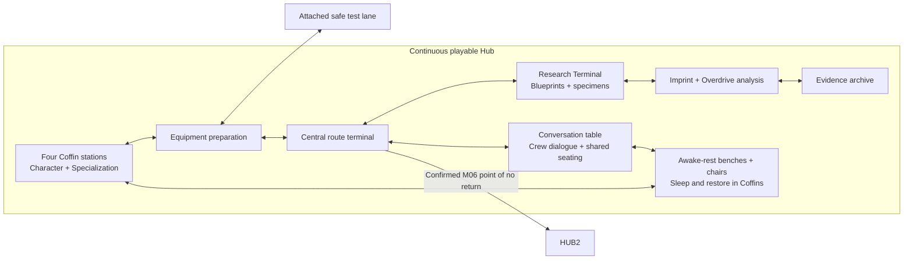

## Visual reference

Generated working reference for the same physical Hub shown in [[Missions/HUB0|HUB0]], now fully staffed and operational after M05. Four Coffins occupy four stations; the crew are outside them, using the space. The central conversation table is ordinary furniture, not another terminal. Benches and chairs provide awake-rest places; there are **no beds, bunks or sleeping mats** because the crew sleep and restore in their personal Coffins.

This is concept art, not a build capture, final floor plan, measured circulation or authored interface. Enabled infrastructure does not mean every Blueprint, Specialization or destination is unlocked. Incidental screen shapes, props, equipment and insignia define no rewards, hidden-route information or crew origins; exact displayed text belongs to gettext.

> **TODO — Hub visual/blocking review:** Validate circulation around all four stations, conversation seating, separate tools, quieter analysis/archive positions and the attached safe test lane at gameplay scale. Check camera framing and crew likeness; the still image does not demonstrate ambient schedules, menu transitions or device handoffs.

## Purpose

> **Accepted** — HUB1 is the fully assembled Act II state of the same physical space used by HUB0. M05 activates existing infrastructure without relocating the crew or changing the architecture and floor plan. The central route terminal, Research Terminal, Imprint and Overdrive analysis interfaces, and evidence archive become functional; lighting and visible data flow connect systems that appeared dormant during HUB0.

Serve as the Act II campaign Hub where the assembled crew prepares and chooses among the four open biome routes.

## Spatial model

> **Accepted** — HUB1 is one compact, continuous side-scrolling space with no loading transitions between functions. The four Coffin stations anchor the roster, the route terminal is visually central, and a short test lane attaches directly to the preparation area. Imprint analysis and evidence review occupy quieter edges without becoming separate rooms.

The schema shows functional adjacency, not a final floor plan. All four rail-connected Character docking stations are now filled. Each station holds the Coffin variant belonging to that Character's selected Specialization; changing Specialization swaps variants by rail.

## Embodied Hub and menu access

> **Working version — Interactive menu:** The player may traverse the continuous Hub and interact with its physical stations, or use a Hub menu shortcut to open the same function without walking there. The two access paths share availability, selections, progress, rewards and confirmations; walking is atmosphere and spatial orientation, not a mandatory preparation tax. The reference is the convenience of a walkable game-ship Hub such as Warframe's, not a literal ship, copied architecture or a second location.

| Physical anchor | Hub menu access / shared function |
|---|---|
| Character-assigned Coffin station | Crew and unlocked Specialization selection; inspect stats, skills and current configuration. |
| Equipment preparation bench | Compatible loadout preparation; does not merge with Coffin selection. |
| Attached test lane | Enter safe, repeatable configuration testing. |
| Central route terminal | Mission selection and explicit departure confirmation. |
| Research Terminal | Blueprint progress, known unlocks and available Hub research boards. |
| Imprint / Overdrive analysis interface | Review recovered capabilities and their available presentation. |
| Evidence archive | Current-operation evidence and visibly separate prior records. |
| Conversation table / available crew | Available crew conversations, with the same story conditions as physical interaction. |

Shortcuts may change station focus/presentation without adding an in-world teleport ability, loading room or elapsed-time requirement. Opening a function never confirms departure, collects a reward again or bypasses an unlock. Returning to ordinary Hub control preserves the current valid configuration. The route terminal remains the single deployment owner even when entered through the menu.

> **TODO — Hub navigation prototype:** Define menu organization, physical interaction prompts, station focus/return framing, safe actor placement and input mapping. Validate that keyboard/controller users can prepare and depart entirely through shortcuts, while neither access path leaks hidden content or duplicates state changes.

## Crew life and resting

> **Working version — Living crew space:** Inactive crew may move between nearby authored activity points, sit at the conversation table, use awake-rest seating, inspect notes, maintain equipment or observe a station. These are noncombat ambient behaviours, not deployed companion AI, vulnerable escorts or a management simulation. They do not consume resources, advance research, unlock content or gate the player's preparation.

Sleep and restoration use the personal Recovery Capsules. Do not add a bedroom or beds to HUB1; the conversation table and benches serve social/awake-rest activity. A Character's Coffin can remain docked while that person is active elsewhere in the Hub.

Keep available conversations and devices reachable regardless of an ambient routine; a crew member moving or resting cannot make story dialogue missable or force a wait. During a station interaction, Mesh Dive or Cutscene, suspend/reframe conflicting activity rather than allowing bodies, dialogue or camera focus to interfere. Resume ordinary ambience afterward without implying a shared historical-memory event.

> **TODO — Ambient crew blocking:** Author compact activity loops, transition priorities, interaction overrides and collision/camera behaviour. The reference image's activities are examples, not permanent jobs; switching control must release the old actor to ambience and stop the new actor's ambient routine without duplicating either body.

## Mission selection

> **Accepted** — One central route terminal owns Hub deployment selection. It presents the four main biome branches as peers and distinguishes completed, available, and unavailable destinations. Discovered Special Missions are indented beneath their source, use the accepted special color, and show only **Optional path — [destination biome]**; the exact downstream Mission, reward, set relationship, and Communion relevance remain hidden.

Coffin stations remain dedicated to Character and Specialization selection. Equipment preparation remains a separate physical area.

## Character preparation

> **Accepted** — Selection exposes Character stats, equipment, skills, and Specialization. A safe, repeatable test space lets the player try movement, attacks, skills, equipment changes, and the Character-owned optional-route verb before deployment.

> **Working version — Hub crew control:** Selecting an available crew member at their Coffin station or through the corresponding crew-menu shortcut transfers ordinary Hub control to that Character. The others remain present as ambient crew. Only unlocked Specializations and compatible Equipment are selectable; this does not permit mid-Mission switching outside M05's authored exception. Player traversal still follows the shared movement model; ambient strolling does not introduce a new player analogue-walk, sprint or stamina state.

### Device-specific control handoff

Any controlled Character may approach a device and browse its generally available functions. A device-specific action can require a particular operator, but browsing alone does not silently switch the crew member or alter the deployment configuration.

[[Gameplay/Blueprints#research-terminal|Research Terminal rules]] already define the Mesh Dive case: any Character may inspect research or select an available board; starting the board temporarily hands execution to RELAY. Completing or leaving the board returns control to the initiating Character without changing the selected Hub Character, Specialization or deployment loadout. Apply the same handoff through physical and menu access. This is a temporary device operator, not selection of RELAY for the next Mission.

> **TODO — Operator-handoff presentation:** Make the required operator and return explicit before starting a Dive; define transition/skip, cancellation, retry and restoration framing without granting an additional capability. Add other forced-operator cases only when their owning device rules require one, rather than assuming every terminal belongs exclusively to one Character.

## Evidence archive

> **Accepted** — The archive separates **Current operation** evidence recovered in this campaign from **Prior records** viewed in previous campaigns. Prior records are visibly archival and never satisfy current-campaign eligibility.

Both views allow individual evidence review but conceal route logic: no biome Memory Imprint `x/4` counter, Specialization `x/12` counter, true-route checklist, or eligibility indicator appears before a non-true ending report reveals the totals.

## M05 activation handoff

[[Missions/M05#profile-interlock-and-final-activation|M05's final core validation]] commits the collective unlock and reconnects the Research Core. The four personal Coffins return separately into the existing stations; this is a state change, not relocation. Ordinary preparation resumes with functional interfaces and no automatic Act II departure. [[Gameplay/Blueprints#activation|Blueprint activation]] owns the starter-record import; Hub presentation does not grant it again.

## Progression

HUB1 unlocks after [[Missions/M05|M05]]. Completed Missions remain replayable. After success, the player may continue directly through an authored outgoing route with the current configuration or return here to reconfigure. Main Missions unlock authored same-biome successors; hidden actions in MA01, MB02, MC02, and MD01 can persistently unlock MS01–MS04. Returning adds discovered Special Missions to the Hub pool. Those Missions can unlock another biome's M02 before its M01 is complete; a bypassed M01 remains available. After all four Guardians are defeated, M06 becomes available at the route terminal but does not start automatically. The player may continue Act II until confirming a warning that entry into [[Missions/HUB2|HUB2]] closes B03–B06 and any undiscovered rewards for that campaign. The warning does not reveal hidden Mission, biome Memory Imprint, Specialization, or route totals.
