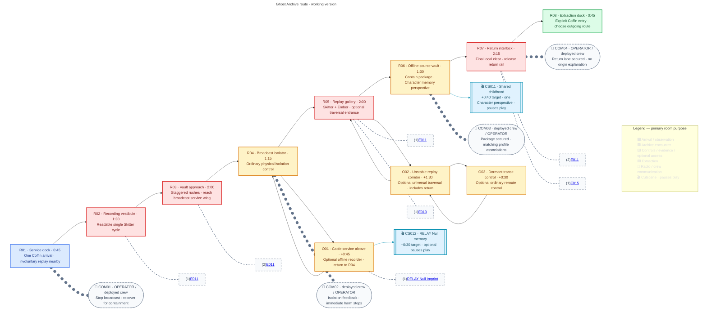

## Purpose

Stop a damaged archive from broadcasting a military memory package into civilian neural systems, recover the package for containment, and reveal that several crew members remember the same childhood from different perspectives.

## Mission framing

| Layer | MA01 direction |
|---|---|
| OPERATOR briefing | Isolate the involuntary broadcast, stabilize affected infrastructure, and recover its source package for containment. |
| Immediate benefit | Nearby civilians stop receiving intrusive military memories and dangerous behavioral loops. |
| Concealed consequence | The recovered package later becomes available for identity analysis or control. |
| Evidence boundary | Recovery genuinely prevents immediate harm; later reuse does not make the original benefit false. |

> **Working version — Open-campaign baseline:** MA01 is one of HUB1's four initially available Act II entries, not a mandatory first choice. Deploy one selected Character/Specialization with the current compatible loadout. Every unlocked configuration can complete the required route by ordinary movement, combat and physical controls; no compulsory Hack, Breach, Wall Climb, Slide, Overdrive or companion is required.

B03 is a cathedral-like archive, not a religious faction briefing or another factory rescue. Repeated vaults, sealed storage bays, echoing service galleries and distorted replay projections establish its material language. Affected civilians remain protected background evidence, not a damageable escort, timed rescue quota or source of the hidden route flag.

## Mission structure

> **TODO — Blockout validation:** Test ordinary traversal, attack-height access, spider commitment/recovery tells and safe control spaces against every Character and unlocked Specialization. The route, counts and timing below are first blockout targets, not measured geometry or balance.

[[Wiki Rules?section=mission-room-graphs|Mission room graphs]] owns notation. Solid room arrows show the required route and optional return paths; Cutscene and communication attachments are not traversable branches.

### Encounter staging

[[Enemies/E011|E011 — Skitter]] is M05's shared B03 preview body. MA01 introduces Skitter rush/recovery, then [[Enemies/E013|Ember]] flame commitment and [[Enemies/E015|Arc]] electrical charge. Enemy-owned behaviour remains independent of these room arrangements; MA02's other spider roles do not add placements here.

These staging rows describe the first operation; restored-world presentation below supplies later-visit variants without changing the finite encounter roster.

| Room | Local purpose and safety |
|---|---|
| R01 | Safe rail step-out. Repeated civilian gestures and intrusive replay flashes are visible beyond the dock; no hostile can attack the arrival position. |
| R02 | One unobstructed lane with a visible safe observation/approach position. Read one Skitter's visible brace, committed short rush and frontal recovery before mixing units. |
| R03 | Separate approaches and staggered commitments. Include ordinary cover and reachable attack height; do not require a high jump or permanent rear access. |
| R04 | Safe service control after R03 clears. Isolate the outbound broadcast while maintaining local source-storage power; civilian background loops visibly settle. No board or combat Access requirement. |
| R05 | One Skitter plus one Ember: stagger rush and narrow flame sweep, preserving an ordinary withdrawal/approach space rather than synchronized crossfire. The optional passage is readable from a safe post-clear position; replay imagery never hides mandatory collision or attacks. |
| R06 | Quiet safe package recovery after R04 isolation and upstream clear. Ordinary interaction secures an offline containment record and triggers CS011; no spider surprise during the memory or resume. |
| R07 | Two Skitters plus one Arc: stagger rushes and electrical charge, with a reachable Arc front and a safe withdrawal margin. No automatic cable hazard or coordinated unavoidable strike. Clear first, then use an ordinary physical interlock control to release the return rail. |
| R08 | Safe one-Coffin extraction; proximity alone never completes the Mission. No final ambush or fragile civilian boarding requirement. |

The graph owns **eight spider placements: six E011, one E013 and one E015** as authored starting tuning values, not a simultaneous-threat quota. Forward encounter access opens after local clears, through visible archive/security hardware. Cleared actors do not respawn or pursue into R01, R04, R06, R08 or optional service spaces. Backtracking through cleared rooms remains available until explicit extraction. No Boss, endless defence, timer, escort bar or factory-wide extermination objective is authored.

These spider archetypes have no allocated Blueprint drop tables yet; their Enemy pages own the persistent-source-value TODOs. Do not invent fragment rewards, research outputs or random pickups to fill this Mission. The Null Imprint is the only fixed reward placement in this pass.

## Broadcast isolation and containment

Before first successful extraction, required order is **R04 outbound isolation → R06 package containment → R07 return-lane release → R08 explicit Coffin entry**. A defeated guard cannot substitute for a control interaction. The isolation does not destroy storage, shut down the whole Basilica or resolve MA02's trafficking operation. Package recovery contains the immediate source; later analysis/control remains a concealed consequence rather than proof that OPERATOR lied about the immediate benefit.

All controls are physically usable by every Character. RELAY may interpret the machinery in communications, but neither field Hack nor a forced control handoff is inserted. Overdrive may be used wherever its ordinary rules permit; it is not a route key. Damaging environmental hazard cycles are not authored on the critical path yet; do not infer them from replay flashes, sound distortion or the SVG.

## Narrative evidence

> **Accepted** — The deployed Character experiences one perspective of the recovered childhood. Archive metadata associates matching fragments with the other crew profiles, and optional HUB1 dialogue reveals that they recognize the same event differently. Replaying MA01 with another Character presents that Character's distinct perspective; Specialization does not change the memory.

The overlap establishes that autobiographical memory can be shared or reassigned, but no perspective is labeled original and the Mission does not explain who first lived it or how it reached the crew.

[[Cutscenes/CS011|CS011]] owns the working shared-childhood panels, four Character viewpoints and 0:40 target. Only the deployed Character's variant plays on a run; the other three are not automatic extra scenes. Partial distribution routing in the contained record identifies a live extraction/distribution site, motivating MA02 without naming the Curator or confirming the crew's alleged sources. Present metadata associations as partial matching records, not a complete donor map, four-part collectible or eligibility counter. Optional HUB1 conversation adds recognition, not a mandatory crew meeting or another Mission objective.

Recovered perspective evidence is registered at package interaction whether its scene is watched or skipped. Keep current-operation records separate from prior-campaign viewed history; later intrusion can review another Character perspective from the already contained record, without changing Specialization, duplicating story evidence/results or requiring all four for completion. Presentation-view history can expand; it does not create another recovered source package.

## Specialization Imprint

> **Accepted** — MA01 contains [[Imprints/Relay Null|RELAY's Null Imprint]]. Disabled recording infrastructure connects its discovery to surveillance and evidence destruction. Collection remains separate from required objectives and the hidden MS01 route condition.

> **Accepted** — A damaged recording cable leads away from the main route into an unmarked service alcove containing an offline recorder. Any Character and Specialization may follow it and interact with the recorder to collect the Imprint. Discovery rewards observation rather than Hack: it requires neither RELAY nor combat Access.

**Working placement:** R04's damaged, unpowered recording cable continues through a low open service threshold to safe O01. Its contrast, broken brackets and silenced recording indicators provide a visual trail; do not add an objective marker, named Character requirement, locked Hack shutter or reward icon. Keep the entrance separate from R05's unstable traversal branch. After the ordinary recorder interaction, [[Cutscenes/CS012|CS012]] presents RELAY's remembered destruction of linked sentries; return to the same deployed Character in O01, then R04.

Collecting directly registers Null and its [[Machine Profiles/NH003|Cascade Virus]] grant for RELAY, even when another Character collects it. It does not switch the deployed Character, change their current Specialization/loadout or provide a temporary Null trial; selecting the newly available configuration requires HUB1. Already registered rewards survive death and cannot be granted twice. A repeat visit may review the memory without another reward. Viewing history from a prior campaign never substitutes for this campaign's collection.

> **TODO — Discovery blocking:** Measure cable visibility, entry sightline, recorder affordance and return framing without a marker. CS012 owns panel/audio production, not the Mission's acquisition state.

## MS01 route

> **Accepted** — An unstable memory-replay corridor forms a difficult optional traversal route available to every Character and Specialization. Reaching its end allows the player to reroute a dormant evacuation or transit connection. The route has no objective marker; machinery and terminal feedback acknowledge the successful action without explaining its campaign significance.

Meeting the condition on a successful run adds **Optional path — Verdant Null** to the extraction Coffin in the special color and persistently unlocks MS01 for the current campaign. MA02 and HUB1 remain available choices, and choosing either does not lose the discovery.

**Working placement:** After R05 clears, an offset service opening leads to O02 and the dead-end O03 transit control. Staggered low solid ledges, a slow reciprocating service carriage and timed shutters make a harder ordinary traversal rhythm; every configuration must have sufficient jump/run margins, safe waiting landings and a lower catch/return walkway. Replay echoes may confuse the scene but never create invisible collisions or fake safe footholds. O02's budget includes the outward and return traversal; O03 is the reroute interaction. Return through O02 to R05, without bypassing R06 or the final interlock.

Explicitly operate O03's ordinary control to stage the transit-rerouted condition; reaching the corridor, defeating enemies or collecting Null does not set it. Show a local mechanical alignment/status response, not a secret-route announcement, destination/reward preview, Biome Memory counter or Communion hint. A failed MA01 run discards this uncommitted local condition; explicit successful extraction commits it. Once committed, later failure cannot relock MS01.

> **TODO — Universal traversal validation:** Author exact carriage/shutter cycles and geometry; validate low-jump RAM and all default configurations without damage, advanced techniques or optional upgrades. Keep the entrance observable without a marker and ensure the control feedback says only that the transit connection changed. No Character signature gate or required Hack board belongs here.

The B03 biome Memory Imprint is on [[Missions/MS01#biome-memory-imprint|MS01]], not a second MA01 collectible or automatic reward for this reroute.

## Cutscenes and communication

| Scene | Trigger | State boundary |
|---|---|---|
| [[Cutscenes/CS011|CS011 — Shared Childhood]] | First-operation R06 containment after isolation; optional secured-record review on later intrusion. | One deployed-Character perspective; watch/skip registers the same evidence and safe resume. Not an original-owner reveal or combat unlock. |
| [[Cutscenes/CS012|CS012 — RELAY Null Memory]] | Optional O01 recorder interaction. | Same Null/program acquisition on watch/skip, no change of deployed Character. Does not set the MS01 condition. |

| COM | Trigger / intent |
|---|---|
| COM01 | R01 arrival: establish involuntary-broadcast containment and observable civilian harm; no omniscient identity explanation. |
| COM02 | R04 isolation: confirm local broadcast cessation and preserve the source package. No new timed rescue or civilian-following objective. |
| COM03 | After CS011 in R06: acknowledge package security and partial matching profile associations, not repeat childhood dialogue or resolve original ownership. Remains meaningful after skip. |
| COM04 | R07 return rail released: confirm extraction availability. No mention of an undiscovered optional route or later ending. |

COM beats overlap active play, are not extra paused Cutscenes and never duplicate scene speech. Pause/resume them around scene playback only while still relevant. Exact wording, gettext entries, translations and optional HUB1 recognition dialogue remain unauthored; do not link absent entries.

## Deployment, completion, and retry

| Trigger | Working result |
|---|---|
| HUB1 deployment | One chosen Character/Specialization travels in their own Coffin to R01; no crew handoff or active companion. MA01 need not be the player's first Act II Mission. |
| Local clear | Open the authored forward access; preserve cleared backtracking and protected noncombat areas. |
| R04 isolation | Stop the outbound feed; preserve source storage and open required containment access. |
| R06 package interaction | Register this Character's perspective evidence; play CS011 or skip to identical safe resume. Containment alone does not complete MA01. |
| O01 recorder | Register Null and Cascade Virus under their owners; CS012 complete/skip returns to the same deployed configuration. Neither required objectives nor MS01 depend on it. |
| O03 reroute | Stage only the local hidden condition until successful extraction. No immediately usable extra MA01 exit. |
| R07 clear + interlock control | Release the R08 return rail; controls never imply universal Hack or destructive-access requirements. |
| R08 before prerequisites | No extraction commitment or outgoing selection; dock proximity is insufficient. |
| Explicit Coffin entry after prerequisites | Commit MA01 success and MA02 availability; if O03 was operated, commit MS01 discovery for the current campaign before choosing a destination. |
| Successful exit selection | Offer MA02, HUB1 and, only when discovered, **Optional path — Verdant Null**. Direct continuation preserves Character, Specialization and Equipment; HUB1 permits reconfiguration. No automatic departure or full-campaign Mission list. |
| Defeat before first successful extraction | Return to HUB1 under shared recovery/retry. Reset local clears, isolation, containment interaction, interlock, optional traversal and uncommitted reroute. Preserve already registered Imprints, program grants, perspective evidence and research progress; viewed scenes do not mark rooms complete. |
| Later intrusion / later failure | MA01 remains accessible while B03 is open. Broadcast isolation and package containment stay committed; no new civilian intrusion loop or mandatory first-completion CS011. Reset current-visit hostile clears, local return-rail access and uncommitted optional reroute only. Already committed MS01 discovery, MA02 availability and story results remain; no duplicate completion/evidence grants. |

### Restored-world visit

After successful extraction, R04 visibly remains isolated and R06 holds a secured review copy. Traversing those rooms does not reactivate the broadcast, repeat containment or generate new first-completion records. CS011 may be reviewed voluntarily with the deployed Character's viewpoint; watch/skip reviews the same contained evidence. COM01/COM02 use intrusion/already-isolated variants and COM03 acknowledges review rather than a new package recovery rather than briefing an active crisis again. Protected civilian presentation shows the corrected state, not the original involuntary loops.

Spiders defend the restored facility against intrusion. R07's current-visit clear and ordinary return-rail release still secure explicit R08 extraction; persistent story repair does not automatically clear new local security. Before first success, previous evidence or Imprint ownership never substitutes for current-run required controls. Later failure never reverses already committed isolation/containment.

Uncollected Null and undiscovered MS01 access remain available under their existing acquisition/commit rules; already owned rewards and records are not granted again. This does not allocate ordinary combat loot or erase optional discoveries. First-completion timing below is not a measured later-intrusion target.

Do not insert a midpoint checkpoint, resource loss, damaged civilian escort state, extra Capsule manufacture or automatic MA02 deployment. A new campaign resets in-campaign Specializations, optional-route discovery and current-operation evidence under their shared owners; prior viewed history remains visibly archival.

## Timing targets

> **TODO — Playtest timing:** Measure room-entry to room-exit for all four default configurations, then unlocked Specializations. Exclude retries, paused scenes and optional travel from the critical-path sample. Whole-run medians are measured independently, not sums of room medians.

| Room | Active target | Observed median | Runs |
|---|---:|---:|---:|
| R01 | 0:45 | — | — |
| R02 | 1:30 | — | — |
| R03 | 2:00 | — | — |
| R04 | 1:15 | — | — |
| R05 | 2:00 | — | — |
| R06 | 1:30 | — | — |
| R07 | 2:15 | — | — |
| R08 | 0:45 | — | — |
| **Critical-path active total** | **12:00** | — | — |

| Planned component | Target |
|---|---:|
| Required active route | 12:00 |
| CS011, one perspective | +0:40 |
| **Required route including unskipped scene** | **12:40** |
| Optional O01 active detour / CS012 | +0:45 / +0:30 |
| Optional O02–O03 outward + return traversal/control | +2:00 |
| **Both optional branches, including unskipped scenes** | **15:55** |

The optional budgets are first-visit planning allowances, not traversal-race requirements. COM overlaps active time; loading, menus, Capsule movement and HUB1 conversation overhead are separately measured. Scene skipping affects presentation time, not objective/reward state. No post-extraction Cutscene is allocated here.

## Layout and visual handoffs

Expand Ghost Archive spatial review schematic

### Generated service-spider comparison

**VIS-60 — first graphics pass:** E011 Skitter is left, E013 Ember centre, E015 Arc right. The paired neutral/work poses establish a shared worn limb/socket family and different functional tools, not three recoloured bodies. Enemy pages own the body/behaviour review; this Mission still owns its eight finite placements. The fixtures and effects are service samples, not additional actors, implicit hazards, measured attack ranges or a Curator encounter. Keep the first-operation versus restored-world room states distinct when producing the next environment studies.

These editable SVGs are working spatial/composition handoffs, not gameplay captures or measured floor plans. Art and blockout review must distinguish the live broadcast, harmless replay projections, spider attack cues and historical memory treatment. Civilian loops stop after isolation without showing that every person has recovered completely or proving who created the package.

> **TODO — Stage 2 refinement:** Validate all-kit combat/geometry, Skitter/Ember/Arc commitments, finite batches and recovery, optional carriage/shutters, isolation/containment hardware, package/evidence feedback, memory viewpoint transitions, exact dialogue and wall-clock targets. Decide spider persistent research value before adding Blueprint drops or Profile outputs. Generated Mission/Enemy/scene art remains a separate production pass; schematics do not define final designs.
