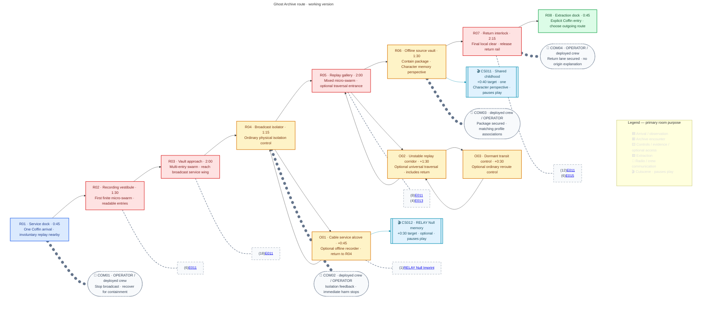

## Mission visual reference

**VIS-69 — current gameplay-composition reference:** A local 2D run-and-gun viewport, not a cinematic view of the entire Basilica. ROOK supplies human scale; tiny helpers supply mass pressure. This is an AI-generated mock screenshot, not a playable build, measured layout, fixed pixel grid, HUD specification or exact on-screen spawn quota. The earlier panoramas below remain architectural mood references only; their oversized robots are not the current scale.

## Purpose

Stop a damaged archive from broadcasting a military memory package into civilian neural systems, recover the package for containment, and reveal that several crew members remember the same childhood from different perspectives.

## Mission framing

| Layer | MA01 direction |
|---|---|
| OPERATOR briefing | Isolate the involuntary broadcast, stabilize affected infrastructure, and recover its source package for containment. |
| Immediate benefit | Nearby civilians stop receiving intrusive military memories and dangerous behavioral loops. |
| Concealed consequence | The recovered package later becomes available for identity analysis or control. |
| Evidence boundary | Recovery genuinely prevents immediate harm; later reuse does not make the original benefit false. |

> **Working version — Open-campaign baseline:** MA01 is one of HUB1's four initially available Act II entries, not a mandatory first choice. Deploy one selected Character/Specialization with the current compatible loadout. Every unlocked configuration can complete the required route by ordinary movement, combat and physical controls; no compulsory Hack, Breach, Wall Climb, Slide, Overdrive or companion is required.

B03 is a cathedral-like archive, not a religious faction briefing or another factory rescue. Repeated vaults, sealed storage bays, echoing service galleries and distorted replay projections establish its material language. Affected civilians remain protected background evidence, not a damageable escort, timed rescue quota or source of the hidden route flag.

## Mission structure

> **TODO — Blockout validation:** Test ordinary traversal, attack-height access, spider commitment/recovery tells and safe control spaces against every Character and unlocked Specialization. The route, counts and timing below are first blockout targets, not measured geometry or balance.

[[Wiki Rules?section=mission-room-graphs|Mission room graphs]] owns notation. Solid room arrows show the required route and optional return paths; Cutscene and communication attachments are not traversable branches.

### Encounter staging

[[Enemies/E011|E011 — Skitter]] is M05's shared B03 preview body. MA01 introduces multi-entry Skitter swarm pressure, then [[Enemies/E013|Ember]] flame commitment and [[Enemies/E015|Arc]] electrical charge. Enemy-owned behaviour remains independent of these room arrangements; MA02's other spider roles do not add placements here.

These staging rows describe the first operation; restored-world presentation below supplies later-visit variants without changing the finite encounter roster.

| Room | Local purpose and safety |
|---|---|
| R01 | Safe rail step-out. Repeated civilian gestures and intrusive replay flashes are visible beyond the dock; no hostile can attack the arrival position. |
| R02 | First finite Skitter group. Show shelf-gap/floor entries and a plainly visible wall/ceiling approach before contact, with an ordinary retreat margin. Teach small-body hit/readability and mass pressure, not an individually armoured machine duel. |
| R03 | Two finite Skitter groups use both screen sides, walls and ceiling/shelf seams, with staggered approach/commitment and readable gaps. Surface travel must lead to reachable engagement; no ceiling-only straggler, compulsory high jump or rear-only weak point. |
| R04 | Safe service control after R03 clears. Isolate the outbound broadcast while maintaining local source-storage power; civilian background loops visibly settle. No board or combat Access requirement. |
| R05 | Mixed tiny Skitter/Ember group: stagger arrivals and small local flame commitments, preserving ordinary withdrawal/approach space rather than synchronized all-side damage. The optional passage is readable from a safe post-clear position; replay imagery never hides mandatory collision or attacks. |
| R06 | Quiet safe package recovery after R04 isolation and upstream clear. Ordinary interaction secures an offline containment record and triggers CS011; no spider surprise during the memory or resume. |
| R07 | Two mixed Skitter/Arc groups: stagger surface arrivals and small electrical commitments, with ordinary-kit reachable bodies and a safe withdrawal margin. No automatic cable hazard or coordinated unavoidable strike. Clear first, then use an ordinary physical interlock control to release the return rail. |
| R08 | Safe one-Coffin extraction; proximity alone never completes the Mission. No final ambush or fragile civilian boarding requirement. |

The graph owns **54 tiny spider placements: 44 E011, four E013 and six E015** as authored starting tuning values, not a simultaneous-threat quota. This replaces the incorrect eight-heavy-unit baseline. R02 starts with one group; R03 uses two groups, R05 one mixed group, R07 two mixed groups. Begin blockout with up to twelve engaged workers per group and separately stagger damaging commitments; exact concurrency, entry delays and group transitions require all-kit density tests. Every group's entrants come from finite authored room reserves, not endless spawns or instant attacks from offscreen. Forward encounter access opens after local clears, through visible archive/security hardware. Cleared actors do not respawn or pursue into R01, R04, R06, R08 or optional service spaces. Backtracking through cleared rooms remains available until explicit extraction. No Boss, endless defence, timer, escort bar or factory-wide extermination objective is authored.

These spider archetypes have no allocated Blueprint drop tables in this Stage-1 baseline: the explicit MA01 disposition is **no ordinary spider loot, fragments, machine extraction result or source-research track**. Their Enemy pages own that reusable source-value disposition; future output additions need their own authored justification, not an unresolved MA01 completion requirement. Do not invent fragment rewards, research outputs or random pickups to fill this Mission. The Null Imprint is the only fixed reward placement in this pass.

### Finite arrival schedule

These are authored starting values, not measured combat timing. A "group" is a finite room reserve, not an instruction to attack simultaneously.

| Group | Skitter | Ember | Arc | Readable local entry allocation |
|---|---:|---:|---:|---|
| R02-A | 6 | 0 | 0 | Two floor-left, two floor-right, one wall, one ceiling descent; release as three visible two-unit arrival pulses. |
| R03-A | 9 | 0 | 0 | Three left, three right, two ceiling descents, one shelf-wall seam. |
| R03-B | 9 | 0 | 0 | Same finite split, reverse first-entry side; do not reuse cleared bodies. |
| R05-A | 8 | 4 | 0 | Skitters split four per side with some wall/ceiling approaches; two Embers per side, descend to reachable local work/attack positions. |
| R07-A | 6 | 0 | 3 | Two Skitters per side, two overhead; one Arc per side and one shelf seam. |
| R07-B | 6 | 0 | 3 | Same finite split with opposite first-entry side. |
| **Total** | **44** | **4** | **6** | **54 workers, no Boss or other Enemy role.** |

Entry mouths must be visible in the bounded gameplay view before release. Use a physical service-slot opening, scrape/click and an intact travelling body—not sudden damaging appearance, decorative background spiders switching allegiance, or invisible ceiling contact. Each arrival pulse waits for a readable approach gap; the initial two-unit pulse spacing target is 1.5 seconds, adjustable after all-kit testing. Workers can accumulate up to the group cap, but movement alone supplies no passive contact damage or an impassable collision wall.

Starting attack arbitration permits at most two damaging commitments at once, at most one of them Ember/Arc, and only when their envelopes leave an ordinary withdrawal/standing-attack position. This is a local density target, not a new global enemy immunity or changed elemental rule. Queue denied commitments with visible worker motion; do not silently shorten tells. If a kit cannot hit a tiny floor body, adjust reachable commitment/engagement geometry rather than requiring an upgrade, high jump or a precision weak point.

For R03/R07, group B begins only after every group-A body is disabled and a nominal two-second neutral breather; show the next service ports preparing. Leaving the room pauses pending release, never respawns defeated workers or sends pursuit into cleared/safe rooms. Re-entry resumes that deployment's finite schedule. Disabled workers lose movement-blocking collision and cannot obscure the next entry/commitment tell; retained debris is cosmetic, not a new salvage Enemy or pickup. Local clear requires **all scheduled groups exhausted and every released hostile disabled**, not an empty instant between groups. This alone opens the forward security fixture. Defeat/new deployment resets reserves; normal backtracking does not.

## Broadcast isolation and containment

Before first successful extraction, required order is **R04 outbound isolation → R06 package containment → R07 return-lane release → R08 explicit Coffin entry**. A defeated guard cannot substitute for a control interaction. The isolation does not destroy storage, shut down the whole Basilica or resolve MA02's trafficking operation. Package recovery contains the immediate source; later analysis/control remains a concealed consequence rather than proof that OPERATOR lied about the immediate benefit.

All controls are physically usable by every Character. RELAY may interpret the machinery in communications, but neither field Hack nor a forced control handoff is inserted. Overdrive may be used wherever its ordinary rules permit; it is not a route key. Damaging environmental hazard cycles are not authored on the critical path yet; do not infer them from replay flashes, sound distortion or the SVG.

### Physical controls and feedback

Required devices are non-destructible quest fixtures. Only ordinary Interact changes their objective state; gunfire, Breach, incidental collision and background cables do not substitute for operation. No interaction spends resources, takes a Hack board, times out or forces a new configuration. Each ready control has a reachable floor position outside hostile access; readiness, latch movement and local audio are independent of colour and dialogue.

| Fixture | Ready / operation | Physical response and repeat use |
|---|---|---|
| R04 outbound coupler | R03 fully clear, first operation; operate one lever. | Outgoing connector retracts and output meter settles; storage lamps/hum remain. Civilian intrusive loops stop without implying full recovery. Repeat use is inspection, not a toggle that restores harm. |
| R06 offline cradle | Isolation set and R05 clear; operate reader/containment latch. | Source is secured offline, evidence registered, CS011 watch/skip resumes at the same safe reader. Required return objective appears independently of voice/subtitles. Repeat use can review but cannot create another source package. |
| O01 recorder | Safe alcove reached by ordinary movement, any configuration. | Inspect inactive recorder; first use registers Null/Cascade Virus immediately. Owned recorder offers review only; no forced loadout switch or collection from merely spotting the cable. |
| O03 transit aligner | Reach the dead-end deck; ordinary interaction. | Small rail/connector aligns and local status acknowledges it. Stages reroute only; no route announcement, preview or immediate MS01 unlock. Repeat use is idempotent. |
| R07 return release | Every R07 group disabled; operate physical interlock. | Rail-lock dogs retract, return signal changes and safe R08 access opens. No damaging cable activation or departure. |
| R08 personal Coffin | First operation: isolation, containment and current return release; restored visit: current return release. | Explicit entry atomically commits applicable results before destination selection. On a restored visit this can still commit a newly staged MS01 discovery, but never repeats first-completion evidence or repair grants. Proximity never commits. A refused premature interaction changes no state. |

English objective/interaction text is registered below in the gameplay catalogue. Audio, power indicators and objective text must communicate the same state with sound muted and after scene skip. Optional prompts appear only at reached devices; they do not mark O01/O02 from the main route.

## Narrative evidence

> **Accepted** — The deployed Character experiences one perspective of the recovered childhood. Archive metadata associates matching fragments with the other crew profiles, and optional HUB1 dialogue reveals that they recognize the same event differently. Replaying MA01 with another Character presents that Character's distinct perspective; Specialization does not change the memory.

The overlap establishes that autobiographical memory can be shared or reassigned, but no perspective is labeled original and the Mission does not explain who first lived it or how it reached the crew.

[[Cutscenes/CS011|CS011]] owns the working shared-childhood panels, four Character viewpoints and 0:40 target. Only the deployed Character's variant plays on a run; the other three are not automatic extra scenes. Partial distribution routing in the contained record identifies a live extraction/distribution site, motivating MA02 without naming the Curator or confirming the crew's alleged sources. Present metadata associations as partial matching records, not a complete donor map, four-part collectible or eligibility counter. Optional HUB1 conversation adds recognition, not a mandatory crew meeting or another Mission objective.

Recovered perspective evidence is registered at package interaction whether its scene is watched or skipped. Keep current-operation records separate from prior-campaign viewed history; later intrusion can review another Character perspective from the already contained record, without changing Specialization, duplicating story evidence/results or requiring all four for completion. Presentation-view history can expand; it does not create another recovered source package.

## Specialization Imprint

> **Accepted** — MA01 contains [[Imprints/Relay Null|RELAY's Null Imprint]]. Disabled recording infrastructure connects its discovery to surveillance and evidence destruction. Collection remains separate from required objectives and the hidden MS01 route condition.

> **Accepted** — A damaged recording cable leads away from the main route into an unmarked service alcove containing an offline recorder. Any Character and Specialization may follow it and interact with the recorder to collect the Imprint. Discovery rewards observation rather than Hack: it requires neither RELAY nor combat Access.

**Working placement:** R04's damaged, unpowered recording cable continues through a low open service threshold to safe O01. Its contrast, broken brackets and silenced recording indicators provide a visual trail; do not add an objective marker, named Character requirement, locked Hack shutter or reward icon. Keep the entrance separate from R05's unstable traversal branch. After the ordinary recorder interaction, [[Cutscenes/CS012|CS012]] presents RELAY's remembered destruction of linked sentries; return to the same deployed Character in O01, then R04.

Collecting directly registers Null and its [[Machine Profiles/NH003|Cascade Virus]] grant for RELAY, even when another Character collects it. It does not switch the deployed Character, change their current Specialization/loadout or provide a temporary Null trial; selecting the newly available configuration requires HUB1. Already registered rewards survive death and cannot be granted twice. A repeat visit may review the memory without another reward. Viewing history from a prior campaign never substitutes for this campaign's collection.

> **TODO — Discovery blocking:** Measure cable visibility, entry sightline, recorder affordance and return framing without a marker. CS012 owns panel/audio production, not the Mission's acquisition state.

## MS01 route

> **Accepted** — An unstable memory-replay corridor forms a difficult optional traversal route available to every Character and Specialization. Reaching its end allows the player to reroute a dormant evacuation or transit connection. The route has no objective marker; machinery and terminal feedback acknowledge the successful action without explaining its campaign significance.

Meeting the condition on a successful run adds **Optional path — Verdant Null** to the extraction Coffin in the special color and persistently unlocks MS01 for the current campaign. MA02 and HUB1 remain available choices, and choosing either does not lose the discovery.

**Working placement:** After R05 clears, an offset service opening leads to O02 and the dead-end O03 transit control. Staggered low solid ledges, a slow reciprocating service carriage and timed shutters make a harder ordinary traversal rhythm; every configuration must have sufficient jump/run margins, safe waiting landings and a lower catch/return walkway that returns to the entrance rather than bypassing the traversal to O03. Replay echoes may confuse the scene but never create invisible collisions or fake safe footholds. O02's budget includes the outward and return traversal; O03 is the reroute interaction. Return through O02 to R05, without bypassing R06 or the final interlock.

Explicitly operate O03's ordinary control to stage the transit-rerouted condition; reaching the corridor, defeating enemies or collecting Null does not set it. Show a local mechanical alignment/status response, not a secret-route announcement, destination/reward preview, Biome Memory counter or Communion hint. A failed MA01 run discards this uncommitted local condition; explicit successful extraction commits it. Once committed, later failure cannot relock MS01.

> **TODO — Universal traversal validation:** Implement and measure the construction/cycle targets below; validate low-jump RAM and all default configurations without damage, advanced techniques or optional upgrades. Keep the entrance observable without a marker and ensure the control feedback says only that the transit connection changed. No Character signature gate or required Hack board belongs here.

### Traversal and discovery construction contract

Stage-1 geometry is parameterized against shared movement, not invented metre/pixel measurements. Let **Jmin** be the smallest ordinary same-height jump reach across eligible kits, **Hmin** their smallest jump rise, **Bmax** the largest standing body height and **Wmax** the largest required standing/support footprint. Measure these from the eventual control prototype; this Mission does not assign shared movement values.

| Element | Authored starting construction / cycle |
|---|---|
| R04 → O01 | Continuous ordinary floor, no jump/slide requirement. A broken unpowered cable leaves the lever's normal observation frame and continues through the open side threshold. Brackets, silhouette and quiet recording lamps supply the trail, not a glowing reward or navigation marker. Recorder and return threshold are readable from one safe local stop. |
| O02 route | Entrance landing → low ledge → carriage crossing → first shutter → intermediate safe landing → second shutter → dead-end O03. Each mandatory rise ≤ 0.4 Hmin; each boarding/disembarking jump ≤ 0.45 Jmin. No moving-platform-to-moving-platform leap. |
| Carriage | One horizontal reciprocating service platform; nominal 12-second cycle: near dwell 2 s, outward travel 4 s, far dwell 2 s, return travel 4 s. Remains a support surface throughout travel; no attack, crushing ceiling or mandatory leap during transit. Motion continues on ordinary backtracking, resets on new deployment. |
| Support dimensions | Carriage/required waiting landings ≥ 2 Wmax; standing headroom ≥ 1.25 Bmax and jump arcs unobstructed. Choose the carriage-channel span longer than an ordinary direct bypass while keeping dock transfers inside the stated margins. Actual dimensions follow measured movement, not this image. |
| Two shutters | Each nominal 10-second cycle: open 5 s, visible/audible closing warning 1 s, closed 4 s; second starts offset by 5 s. Crossing span takes ≤ 2 s at the slowest ordinary run. A between-shutter safe landing allows waiting through any phase. Occupancy holds closure until the Character is clear, then resumes its local cycle; no crush damage or forced dash. |
| Missed crossing | Continuous nonlethal lower catch walkway returns to the entrance. A solid separator blocks access upward to the far control; the only return opening is at the entrance, never stairs/a lift directly into O03. A missed platform does not grant the reroute flag or bypass the route. |
| Return | Reverse the same upper route or use the lower return walkway; no timed escape, extra exit or compulsory advanced move. O03 is not a Coffin dock. |

These are complete construction/cycle **targets**, not evidence that the current game supports the dimensions or timings. Stage 2 measures movement, adjusts margins and tests occupancy holds, camera bounds, landing/reversal and the full outward/return route for all kits. No damaging critical-path hazard or ambient elemental immunity requirement is added.

The B03 biome Memory Imprint is on [[Missions/MS01#biome-memory-imprint|MS01]], not a second MA01 collectible or automatic reward for this reroute.

## Cutscenes and communication

| Scene | Trigger | State boundary |
|---|---|---|
| [[Cutscenes/CS011|CS011 — Shared Childhood]] | First-operation R06 containment after isolation; optional secured-record review on later intrusion. | One deployed-Character perspective; watch/skip registers the same evidence and safe resume. Not an original-owner reveal or combat unlock. |
| [[Cutscenes/CS012|CS012 — RELAY Null Memory]] | Optional O01 recorder interaction. | Same Null/program acquisition on watch/skip, no change of deployed Character. Does not set the MS01 condition. |

| COM | Trigger / intent |
|---|---|
| COM01 | R01 arrival: establish involuntary-broadcast containment and observable civilian harm; no omniscient identity explanation. |
| COM02 | R04 isolation: confirm local broadcast cessation and preserve the source package. No new timed rescue or civilian-following objective. |
| COM03 | After CS011 in R06: acknowledge package security and partial matching profile associations, not repeat childhood dialogue or resolve original ownership. Remains meaningful after skip. |
| COM04 | R07 return rail released: confirm extraction availability. No mention of an undiscovered optional route or later ending. |

COM beats overlap active play, are not extra paused Cutscenes and never duplicate scene speech. Pause/resume them around scene playback only while still relevant. The English source below is authored; every ID exists in all configured locales, with non-English translations explicitly pending rather than copied English. Voice recording and actual delivery timing remain production work.

### English communication source

| Beat | Delivery selection | English entry |
|---|---|---|
| COM01 | First operation: OPERATOR instruction, then deployed response | [[locale/en/dialogue.po?entry=dialogue.ma01.com01.l001|dialogue.ma01.com01.l001]] |
| COM02 | First operation: deployed report, then OPERATOR follow-up | [[locale/en/dialogue.po?entry=dialogue.ma01.com02.l001|dialogue.ma01.com02.l001]] |
| COM03 | First operation: deployed association report, then OPERATOR routing | [[locale/en/dialogue.po?entry=dialogue.ma01.com03.l001|dialogue.ma01.com03.l001]] |
| COM04 | After return-rail release, either visit mode | [[locale/en/dialogue.po?entry=dialogue.ma01.com04.l001|dialogue.ma01.com04.l001]] |
| COM01 revisit | R01 after committed repair; no active-crisis briefing | [[locale/en/dialogue.po?entry=dialogue.ma01.com01.revisit.l001|dialogue.ma01.com01.revisit.l001]] |
| COM02 revisit | First safe R04 inspection; deployed voice then OPERATOR | [[locale/en/dialogue.po?entry=dialogue.ma01.com02.revisit.l001|dialogue.ma01.com02.revisit.l001]] |
| COM02 revisit follow-up | Only after the preceding report | [[locale/en/dialogue.po?entry=dialogue.ma01.com02.revisit.l002|dialogue.ma01.com02.revisit.l002]] |
| COM03 revisit | Only after optional R06 review; deployed voice then OPERATOR | [[locale/en/dialogue.po?entry=dialogue.ma01.com03.revisit.l001|dialogue.ma01.com03.revisit.l001]] |
| COM03 revisit follow-up | Only after the preceding review report | [[locale/en/dialogue.po?entry=dialogue.ma01.com03.revisit.l002|dialogue.ma01.com03.revisit.l002]] |

| Deployed Character | First-operation response entries for COM01 / COM02 / COM03 |
|---|---|
| ROOK | [[locale/en/dialogue.po?entry=dialogue.ma01.com01.rook.l001|dialogue.ma01.com01.rook.l001]] / [[locale/en/dialogue.po?entry=dialogue.ma01.com02.rook.l001|dialogue.ma01.com02.rook.l001]] / [[locale/en/dialogue.po?entry=dialogue.ma01.com03.rook.l001|dialogue.ma01.com03.rook.l001]] |
| VECTOR | [[locale/en/dialogue.po?entry=dialogue.ma01.com01.vector.l001|dialogue.ma01.com01.vector.l001]] / [[locale/en/dialogue.po?entry=dialogue.ma01.com02.vector.l001|dialogue.ma01.com02.vector.l001]] / [[locale/en/dialogue.po?entry=dialogue.ma01.com03.vector.l001|dialogue.ma01.com03.vector.l001]] |
| RAM | [[locale/en/dialogue.po?entry=dialogue.ma01.com01.ram.l001|dialogue.ma01.com01.ram.l001]] / [[locale/en/dialogue.po?entry=dialogue.ma01.com02.ram.l001|dialogue.ma01.com02.ram.l001]] / [[locale/en/dialogue.po?entry=dialogue.ma01.com03.ram.l001|dialogue.ma01.com03.ram.l001]] |
| RELAY | [[locale/en/dialogue.po?entry=dialogue.ma01.com01.relay.l001|dialogue.ma01.com01.relay.l001]] / [[locale/en/dialogue.po?entry=dialogue.ma01.com02.relay.l001|dialogue.ma01.com02.relay.l001]] / [[locale/en/dialogue.po?entry=dialogue.ma01.com03.relay.l001|dialogue.ma01.com03.relay.l001]] |

COM01 orders OPERATOR then selected response; COM02/COM03 order selected response then OPERATOR. Only one Character variant plays. Queue radio lines serially; CS011/CS012 pause the queue. Resume an interrupted line once only if its objective is still relevant; drop obsolete instructions and keep the current objective visible. COM02/COM03 begin after device feedback/scene safe resume, never delay control or require listening. Once-per-deployment guards prevent repeated proximity chatter. Restored COM02 occurs on safe inspection, COM03 only on voluntary review; COM04 is shared. Muting/skipping audio cannot suppress state changes.

### Optional HUB1 recognition

After first successful MA01 extraction, offer [[locale/en/gameplay.po?entry=game.ma01.hub.topic|game.ma01.hub.topic]] through the existing physical/menu conversation function. The initiating Character and one selected other crew member each deliver their viewpoint line, then the initiator's closure. Their ordinary availability is independent of ambient seating/pathing; no forced four-person meeting, resource cost, extra Cutscene, evidence grant or requirement to view all perspectives. Repeated discussion is presentation only.

| Speaker | Perceived viewpoint | Initiator-only closure |
|---|---|---|
| ROOK | [[locale/en/dialogue.po?entry=dialogue.ma01.hub.rook.view|dialogue.ma01.hub.rook.view]] | [[locale/en/dialogue.po?entry=dialogue.ma01.hub.rook.close|dialogue.ma01.hub.rook.close]] |
| VECTOR | [[locale/en/dialogue.po?entry=dialogue.ma01.hub.vector.view|dialogue.ma01.hub.vector.view]] | [[locale/en/dialogue.po?entry=dialogue.ma01.hub.vector.close|dialogue.ma01.hub.vector.close]] |
| RAM | [[locale/en/dialogue.po?entry=dialogue.ma01.hub.ram.view|dialogue.ma01.hub.ram.view]] | [[locale/en/dialogue.po?entry=dialogue.ma01.hub.ram.close|dialogue.ma01.hub.ram.close]] |
| RELAY | [[locale/en/dialogue.po?entry=dialogue.ma01.hub.relay.view|dialogue.ma01.hub.relay.view]] | [[locale/en/dialogue.po?entry=dialogue.ma01.hub.relay.close|dialogue.ma01.hub.relay.close]] |

### Objective and device text

| Placement | English gameplay entry | Boundary |
|---|---|---|
| R01 | [[locale/en/gameplay.po?entry=game.ma01.objective.isolate|game.ma01.objective.isolate]] | Required objective, source power preserved. |
| R04 | [[locale/en/gameplay.po?entry=game.ma01.objective.contain|game.ma01.objective.contain]] | Required objective, safe R06. |
| R06 | [[locale/en/gameplay.po?entry=game.ma01.objective.return|game.ma01.objective.return]] | Shown after CS011 watch or skip; no location marker for optional content. |
| R07 | [[locale/en/gameplay.po?entry=game.ma01.objective.extract|game.ma01.objective.extract]] | Completion requires explicit interaction. |
| R01 | [[locale/en/gameplay.po?entry=game.ma01.objective.revisit|game.ma01.objective.revisit]] | Restored-world visit; no repeated broadcast crisis. |
| R04 | [[locale/en/gameplay.po?entry=game.ma01.control.isolate|game.ma01.control.isolate]] | Physical Interact label, no Hack. |
| R04 | [[locale/en/gameplay.po?entry=game.ma01.feedback.isolated|game.ma01.feedback.isolated]] | State feedback, no whole-facility shutdown. |
| R04 | [[locale/en/gameplay.po?entry=game.ma01.feedback.restored|game.ma01.feedback.restored]] | Later safe inspection, does not toggle repair off. |
| R06 | [[locale/en/gameplay.po?entry=game.ma01.control.contain|game.ma01.control.contain]] | First-operation ordinary interaction. |
| R06 | [[locale/en/gameplay.po?entry=game.ma01.feedback.contained|game.ma01.feedback.contained]] | Objective information survives scene skip, no donor field. |
| R06 | [[locale/en/gameplay.po?entry=game.ma01.control.review|game.ma01.control.review]] | Optional on later visits, no new source grant. |
| O01 | [[locale/en/gameplay.po?entry=game.ma01.control.recorder|game.ma01.control.recorder]] | Prompt appears only when physically near, not an objective marker. |
| O01 | [[locale/en/gameplay.po?entry=game.ma01.feedback.null|game.ma01.feedback.null]] | After first collection, no forced Character or Specialization switch. |
| O01 | [[locale/en/gameplay.po?entry=game.ma01.feedback.recorder.review|game.ma01.feedback.recorder.review]] | Owned reward, no duplicate acquisition. |
| O03 | [[locale/en/gameplay.po?entry=game.ma01.control.reroute|game.ma01.control.reroute]] | Only appears at reached control; does not preview secret route or ending. |
| O03 | [[locale/en/gameplay.po?entry=game.ma01.feedback.rerouted|game.ma01.feedback.rerouted]] | Local response only; hidden route commits on successful extraction. |
| R07 | [[locale/en/gameplay.po?entry=game.ma01.control.rail|game.ma01.control.rail]] | Only interact after local clear. |
| R07 | [[locale/en/gameplay.po?entry=game.ma01.feedback.rail|game.ma01.feedback.rail]] | Safe R08 access, not automatic departure. |
| R08 | [[locale/en/gameplay.po?entry=game.ma01.control.extract|game.ma01.control.extract]] | Explicit completion interaction. |
| R08 | [[locale/en/gameplay.po?entry=game.ma01.feedback.blocked|game.ma01.feedback.blocked]] | Defensive invalid-state response; normally room graph prevents premature access. |
| R08 | [[locale/en/gameplay.po?entry=game.ma01.exit.continue|game.ma01.exit.continue]] | MA02 choice after success. |
| R08 | [[locale/en/gameplay.po?entry=game.ma01.exit.hub|game.ma01.exit.hub]] | Reconfiguration at Hub. |
| R08 | [[locale/en/gameplay.po?entry=game.ma01.exit.optional|game.ma01.exit.optional]] | Only discovered route; existing consistent special colour/indentation, no MS01 label. |
| HUB1 | [[locale/en/gameplay.po?entry=game.ma01.hub.topic|game.ma01.hub.topic]] | Optional conversation; no resource spend or completion requirement. |

## Deployment, completion, and retry

| Trigger | Working result |
|---|---|
| HUB1 deployment | One chosen Character/Specialization travels in their own Coffin to R01; no crew handoff or active companion. MA01 need not be the player's first Act II Mission. |
| Local clear | Open the authored forward access; preserve cleared backtracking and protected noncombat areas. |
| R04 isolation | Stop the outbound feed; preserve source storage and open required containment access. |
| R06 package interaction | Register this Character's perspective evidence; play CS011 or skip to identical safe resume. Containment alone does not complete MA01. |
| O01 recorder | Register Null and Cascade Virus under their owners; CS012 complete/skip returns to the same deployed configuration. Neither required objectives nor MS01 depend on it. |
| O03 reroute | Stage only the local hidden condition until successful extraction. No immediately usable extra MA01 exit. |
| R07 clear + interlock control | Release the R08 return rail; controls never imply universal Hack or destructive-access requirements. |
| R08 before prerequisites | No extraction commitment or outgoing selection; dock proximity is insufficient. |
| Explicit Coffin entry after prerequisites | Commit MA01 success and MA02 availability; if O03 was operated, commit MS01 discovery for the current campaign before choosing a destination. |
| Successful exit selection | Offer MA02, HUB1 and, only when discovered, **Optional path — Verdant Null**. Direct continuation preserves Character, Specialization and Equipment; HUB1 permits reconfiguration. No automatic departure or full-campaign Mission list. |
| Defeat before first successful extraction | Return to HUB1 under shared recovery/retry. Reset local clears, isolation, containment interaction, interlock, optional traversal and uncommitted reroute. Preserve already registered Imprints, program grants, perspective evidence and research progress; viewed scenes do not mark rooms complete. |
| Later intrusion / later failure | MA01 remains accessible while B03 is open. Broadcast isolation and package containment stay committed; no new civilian intrusion loop or mandatory first-completion CS011. Reset current-visit hostile clears, local return-rail access and uncommitted optional reroute only. Already committed MS01 discovery, MA02 availability and story results remain; no duplicate completion/evidence grants. |

### Restored-world visit

After successful extraction, R04 visibly remains isolated and R06 holds a secured review copy. Traversing those rooms does not reactivate the broadcast, repeat containment or generate new first-completion records. CS011 may be reviewed voluntarily with the deployed Character's viewpoint; watch/skip reviews the same contained evidence. COM01/COM02 use intrusion/already-isolated variants rather than briefing an active crisis again; COM03 acknowledges review rather than a new package recovery. Protected civilian presentation shows the corrected state, not the original involuntary loops.

Spiders defend the restored facility against intrusion. R07's current-visit clear and ordinary return-rail release still secure explicit R08 extraction; persistent story repair does not automatically clear new local security. Before first success, previous evidence or Imprint ownership never substitutes for current-run required controls. Later failure never reverses already committed isolation/containment.

Uncollected Null and undiscovered MS01 access remain available under their existing acquisition/commit rules; already owned rewards and records are not granted again. This does not allocate ordinary combat loot or erase optional discoveries. First-completion timing below is not a measured later-intrusion target.

Do not insert a midpoint checkpoint, resource loss, damaged civilian escort state, extra Capsule manufacture or automatic MA02 deployment. A new campaign resets in-campaign Specializations, optional-route discovery and current-operation evidence under their shared owners; prior viewed history remains visibly archival.

### Documented state-check matrix

The following are specification checks, not results from a running game. "Local" means this deployment; "committed" means current-campaign repair/unlock. Viewed-history remains presentation data, never a prerequisite substitute.

| Case | Expected state / resume |
|---|---|
| Defeat before isolation | Restart local route at R01 via HUB1; no completion or successor unlock. |
| Isolate, then defeat | First-operation isolation resets; no committed repair yet. |
| Contain, then defeat | Local isolation/containment reset; already registered evidence survives; current-run controls still required. |
| Collect Null, then defeat | Null and Cascade Virus stay registered; same next selected configuration rules, no duplicate grant. |
| Reroute, then defeat | Uncommitted reroute discarded; MS01 remains locked unless previously committed. |
| Collect Null without reroute | No MS01 condition; Null alone never changes outgoing paths. |
| Reroute without Null | Successful explicit extraction can unlock MS01; Null is not required. |
| CS011 watch versus skip | Same evidence, contained package, deployed configuration and safe R06 resume; neither completes MA01. |
| CS012 watch versus skip | Same immediate acquisition and safe O01 resume; no containment/reroute state changed. |
| Empty gap before group B | Room remains uncleared; next finite group still pending, forward access closed. |
| Leave/re-enter active room | Same defeated bodies and pending reserves; no fresh full wave or safe-room pursuit. |
| Coffin proximity / early entry | No completion, destination selection or hidden-route commit. |
| Valid first explicit entry | Commit repair, MA02 availability and staged MS01 unlock atomically; then offer authored destinations. |
| Choose MA02 or HUB1 after reroute | MS01 stays committed regardless of chosen destination; direct continuation preserves configuration. |
| Repeat recorder or containment | Review only where allowed; no duplicate rewards/source/story records. |
| Later intrusion / defeat | Broadcast stays isolated and package contained; local security/rail reset, committed discoveries remain. |
| Later visit with another Character | Optional viewpoint review expands presentation history, not another recovered package or completion credit. |
| Prior-campaign viewed history | Can skip presentation, never auto-collect Null, operate controls or unlock MS01 in a new campaign. |

## Timing targets

> **TODO — Playtest timing:** Measure room-entry to room-exit for all four default configurations, then unlocked Specializations. Exclude retries, paused scenes and optional travel from the critical-path sample. Whole-run medians are measured independently, not sums of room medians.

| Room | Active target | Observed median | Runs |
|---|---:|---:|---:|
| R01 | 0:45 | — | — |
| R02 | 1:30 | — | — |
| R03 | 2:00 | — | — |
| R04 | 1:15 | — | — |
| R05 | 2:00 | — | — |
| R06 | 1:30 | — | — |
| R07 | 2:15 | — | — |
| R08 | 0:45 | — | — |
| **Critical-path active total** | **12:00** | — | — |

| Planned component | Target |
|---|---:|
| Required active route | 12:00 |
| CS011, one perspective | +0:40 |
| **Required route including unskipped scene** | **12:40** |
| Optional O01 active detour / CS012 | +0:45 / +0:30 |
| Optional O02–O03 outward + return traversal/control | +2:00 |
| **Both optional branches, including unskipped scenes** | **15:55** |

The optional budgets are first-visit planning allowances, not traversal-race requirements. COM overlaps active time; loading, menus, Capsule movement and HUB1 conversation overhead are separately measured. Scene skipping affects presentation time, not objective/reward state. No post-extraction Cutscene is allocated here.

## Layout and visual handoffs

Expand Ghost Archive spatial review schematic

## Screen composition and parallax

### Gallery micro-swarm gameplay study

The primary VIS-69 frame shows R03's local action slice: sharp ROOK/bug/floor silhouettes, visible entries from both sides and overhead, recessed shelf banks and partial distant gallery shafts. On-screen population is a density stress study, not the graph's measured simultaneous activation or a final hitbox map. ROOK is an illustrative ranged-kit sample, not the only allowed Character.

### Mixed-swarm gameplay study

**VIS-70:** The same human-to-helper scale with a minority of Ember tools in the swarm. Small local effects must not conceal floor bodies, gaps or approach tells. The screenshot-like frame is not final sprites, exact pixel density, an approved HUD or an allocated flame/status value; high/low service shapes still need collision and all-kit reach validation.

### Layer ownership handoff

| Layer | Contents and compositional job |
|---|---|
| Far depth | Dim vault ribs, shaft/galleries and occasional distant light; slowest relative movement. The full monumental height stays offscreen and is inferred through cropped columns and distant gaps. |
| Recessed archive | Shelf banks/readers and noninteractive wiring behind action; lower contrast and slower movement than the playable plane. |
| Action/collision plane | Actual floor, authored ledges, entry mouths, Characters and hostile bodies; sharp edges, aligned motion and readable attack/withdrawal space. A background shelf is not automatically a platform. |
| Nearest foreground | Cropped dark posts, shelf rims and cable edges with stronger relative movement; frame depth without covering Character silhouettes, small enemies or commitment tells. |

These are layer/contrast ownership targets, not approved scroll coefficients or a rendering pipeline. Use [[Gameplay/Mechanics#camera|shared smooth side-follow]], dead zones, movement look-ahead and authored bounds; do not zoom out to fit the whole vault, move the baseline camera merely for aiming or force scrolling to sustain swarm pressure. The diagrams/frames still need motion, occlusion, contrast and actual weapon-hit testing, especially RAM/RELAY versus low bodies and ceiling arrivals.

## Generated environment references

**Earlier architectural mood/prop studies — not gameplay composition or helper scale.** VIS-61–67 retain room materials, control-state and safety intentions only. Their oversized robots and zoomed-out cinematic framing are superseded by VIS-68–70; do not build camera, actor scale or swarm populations from them.

VIS-62–67 refine room identity, ordinary controls and safe/hostile separation. These are concept references, not gameplay captures, approved collision layouts, attack ranges, hazard timing or completed blockouts. The authored SVGs remain editable spatial handoffs. Characters and protected civilian presentation are omitted here to focus on architecture, not removed from the Mission. Physical junction hubs/background cables are equipment, not extra enemies; wire-web decoration is not automatically hazardous. Exact text belongs to gettext.

### Arrival and recording vestibule

**VIS-62:** Earlier sparse-composition study, not current swarm counts. Left: safe R01 with one personal Coffin. Right: separate R02 with one Skitter and readable observation/withdrawal space. The divider keeps the hostile lane distinct from the dock; these are adjacent reference panels, not a new shared battlefield.

### Broadcast isolator state study

**VIS-63:** Left: first-operation outgoing feed active. Right: isolated/restored state, with source storage and ordinary facility power retained. The coupling/lever study is not a literal puzzle solution, a Hack gate, whole-archive shutdown or permission to restart the harmful broadcast on later visits.

### Offline containment vault

**VIS-64:** R06 is quiet present-day containment/review space after isolation: a sealed package cradle, ordinary reader and safe floor. The indistinct screen supplies no donor identity, childhood location, new records or additional reward; CS011 remains a separately owned memory scene.

### Offline-recorder alcove

**VIS-65:** O01 uses an open service threshold, damaged unpowered cable and offline recorder—not a Hack gate, glowing collectible or transit objective. This is present-day discovery scenery, separate from CS012's historical machines. Cable visibility and reach still require blockout review.

### Replay corridor and dormant transit control

**VIS-66:** O02–O03 samples shutters, low service-platform variation, carriage and a lower catch/return walkway. The revised lower route returns to the entrance; it does not provide stairs directly to the far control. O03 remains a dead end with ordinary rerouting hardware, not another exit or a Verdant Null reveal. Exact cycles, gaps and low-jump RAM margins remain unmeasured.

### Return interlock and protected extraction

**VIS-67:** Earlier sparse-composition study, not the current R07 swarm population. Left: two enlarged Skitters and one Arc, plus an ordinary return-rail release. Right: safe R08 with one Coffin and no hostile. The panels do not combine combat with extraction or authorize an ambush, compulsory Hack, automatic departure or another Boss.

## Generated service-spider comparison

**VIS-68 — corrected scale reference:** E011 Skitter, E013 Ember and E015 Arc are tiny helpers beside ROOK, not heavy machinery. B03 owns the 30–50 cm full-footprint target; the image is a scale/readability candidate, not a measured rig or a Mission placement. Different tiny tools and muted accents still identify roles at gameplay size.

Earlier enlarged tooling sheet — scale superseded

VIS-60 is historical tooling/material reference only. Its large chassis and close-up detail density are not the current swarm baseline.

These editable SVGs are working spatial/composition handoffs, not gameplay captures or measured floor plans. Art and blockout review must distinguish the live broadcast, harmless replay projections, spider attack cues and historical memory treatment. Civilian loops stop after isolation without showing that every person has recovered completely or proving who created the package.

## Stage-1 closeout

**Stage 1 is complete as a document-reviewed working baseline, not approval or playable validation.** Route/placements, six finite arrival groups, safe control contracts, optional discovery/traversal targets, first/retry/restored state cases, English dialogue/UI with registered locale IDs, scene schedules/variants and visual/layer handoffs are authored. Current spider research/loot is explicitly none. Static checks cover counts, links, catalogues, scene-duration arithmetic and handoff invariants; they do not prove collision, combat or runtime persistence.

Proceed to [[Missions/MA02|MA02 — Familiar Strangers]] next. Do not reopen MA01's route or invent more rewards merely to eliminate production TODOs.

> **TODO — Stage 2 implementation and measurement:** Validate all-kit combat/geometry, low-body hit intersections, finite arrivals/attack arbitration, carriage/shutter cycles and occupancy holds, control/evidence feedback, watch/skip and retry/revisit state in the engine, camera/parallax in motion and measured wall-clock targets. Refine final sprites/rigs/animation, recorded audio and native-language translations after the authored English and scene handoffs. Schematics and generated panels do not define final anatomy or measured designs; shared Directional Attack and combat math remain with their owners.
